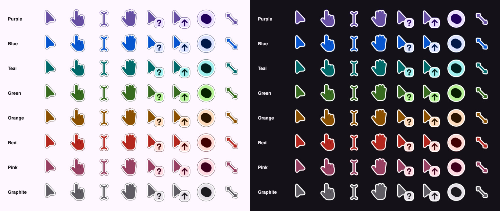

# M3E Cursors

Material 3 Expressive cursor themes in eight colours, for **macOS** (via
[MaCursor](https://github.com/writronic/MaCursor)), **Windows** and **Linux** (KDE Plasma, GNOME
and other desktops that use Xcursor themes).


Every cursor shares one shape vocabulary:

- **Shapes:** soft rounded corners, pills, and a squircle FAB badge.
- **Colours:** one M3 tonal palette per variant.
- **Edges:** a white rim and a thin dark hairline, so each cursor stays visible on light, dark and
  busy backgrounds.

The busy cursor is the official M3E **contained loading indicator**, rendered from
`@m3e/web`'s own `<m3e-loading-indicator>` component.

| | |
|---|---|
|  |  |
| Wait: official contained loading indicator, 4.666 s loop at 60 fps (GIF shown at 20 fps) | Copy / upload drop: FAB plus springs into an upload arrow |

## Download

Get the build for your platform from the
[latest release](https://github.com/XDanfr/M3E-Cursors/releases/latest):

| Platform | Download | Contains |
|---|---|---|
| macOS (MaCursor) | `M3E-Cursors-macOS.zip` | `M3E-<Colour>.cursor` and `M3E-<Colour>-ReducedMotion.cursor` for every colour. Also in [`dist/macos`](dist/macos) |
| Windows 10 / 11 | `M3E-Cursors-Windows.zip` | One folder per colour with `.cur` / `.ani` files and `install.inf` |
| Linux (KDE, GNOME, …) | `M3E-Cursors-Linux.tar.gz` | Every colour as an Xcursor theme. Single-colour archives (`M3E-<Colour>.tar.gz`) are attached too, ready for the KDE Store / Pling |

## Colour variants



| Variant | Body (T40) | Badge (T90) | Glyph / edge (T10) |
|---|---|---|---|
| Purple | `#6750A4` | `#EADDFF` | `#21005D` |
| Blue | `#0856CF` | `#DAE2FF` | `#001847` |
| Teal | `#006A6A` | `#A0F0F0` | `#002020` |
| Green | `#386A20` | `#B8F398` | `#072100` |
| Orange | `#8B5000` | `#FFDCBE` | `#2D1600` |
| Red | `#B4271F` | `#FFDAD5` | `#410001` |
| Pink | `#984061` | `#FFD9E2` | `#3E001D` |
| Graphite | `#605D64` | `#E6E0E9` | `#1D1B20` |

Each variant takes tones 40, 30, 90 and 10 from the M3 tonal palette of its seed colour, using
Google's [material-color-utilities](https://github.com/material-foundation/material-color-utilities).
Purple keeps the M3 baseline values. Graphite is the purple hue at very low chroma.

## Install

### macOS (MaCursor)

1. Install MaCursor (macOS 13 or later; tested on macOS 26.7.1 with MaCursor 2.7.5).
2. Double-click a theme, for example `M3E-Purple.cursor`. You can also drag it onto MaCursor's
   library window, or use **File → Import Theme…**. If MaCursor is running only in the menu bar,
   open its library window first. A double-clicked theme can be dropped silently when no window
   is open.
3. Select the theme, for example **M3E Cursor Purple**, and click **Apply**.

Every colour also comes as `M3E-<Colour>-ReducedMotion.cursor`. It's the same theme, but every
animated cursor holds its first frame. Cursors can't read the system's *Reduce motion* setting, so
reduced motion has to be a separate theme. To switch automatically, use MaCursor's per-app or
scheduled themes.

To change the size, use MaCursor → Settings → Cursor Control → **Cursor Scale**. Every slot ships
at 32, 64 and 160 px, and static cursors also at 320 px. They stay sharp up to 5× on Retina, and
static cursors up to 10×.

### Windows 10 / 11

1. Unzip `M3E-Cursors-Windows.zip` and open the folder for your colour, for example `M3E-Purple`.
2. Right-click `install.inf` and choose **Install**. On Windows 11 it's under **Show more
   options**. Windows asks for administrator approval, because the cursors are copied to
   `C:\Windows\Cursors\M3E Purple`.
3. Open **Settings → Bluetooth & devices → Mouse → Additional mouse settings → Pointers**, choose
   **M3E Purple** in the **Scheme** list and click **Apply**.

Every `.cur` holds 32, 48, 64, 96, 128 and 256 px images, and the animated `.ani` files hold 32 to
128 px. Windows picks the image that matches **Settings → Accessibility → Mouse pointer and touch
→ Size** and your display scale.

### Linux (KDE Plasma, GNOME and others)

**KDE Plasma:** open **System Settings → Colors & Themes → Cursors**, click **Install from File…**
and pick `M3E-Purple.tar.gz` (or the combined archive). Then select **M3E Purple** and apply.

**Any desktop:** extract the archive into `~/.local/share/icons/` (or `~/.icons/`), so you get
`~/.local/share/icons/M3E-Purple/`. Then pick the theme:

- **GNOME:** in GNOME Tweaks under **Appearance → Cursor**, or run
  `gsettings set org.gnome.desktop.interface cursor-theme 'M3E-Purple'`.
- **Other desktops:** in your desktop's cursor settings, or set `XCURSOR_THEME=M3E-Purple`.

**Hyprland:** the same folder is also a [Hyprcursor](https://github.com/hyprwm/hyprcursor) theme,
with a `manifest.hl` and `hyprcursors/*.hlc` next to the Xcursor files. Static cursors and the upload
animation are SVG, so they stay sharp at any size. After extracting, set it in `hyprland.conf`:

```ini
env = HYPRCURSOR_THEME,M3E-Purple
env = HYPRCURSOR_SIZE,24
env = XCURSOR_THEME,M3E-Purple
env = XCURSOR_SIZE,24
```

Keep the `XCURSOR_*` lines: XWayland apps and some toolkits still read the Xcursor theme.

> [!NOTE]
> The Hyprcursor theme is untested. It's built from Hyprcursor's documented format and checked
> against the rules in its loader, but nobody has run it on Hyprland yet.

Each theme ships the nominal sizes 24, 32, 48, 64 and 96. The 280-frame loading animation is
stored at 30 fps on Linux (140 frames, the same 4.666 s cycle) to keep the files a sensible size.

## Supported roles

41 designs in all. On macOS, 37 of them cover 47 MaCursor slots.

### macOS

| Design | macOS role(s) | Hotspot (pt) |
|---|---|---|
| Default arrow | `Arrow`, `ArrowS` (Tahoe) | tip (5.9, 4.1) |
| Link pointer | `cursor.13` PointingHand | fingertip |
| Text I-beam | `IBeam`, `IBeamS` (Tahoe), `IBeamXOR` | centre |
| Vertical text | `cursor.26` IBeamH | centre |
| Help | `cursor.40` | arrow tip |
| Context menu | `ArrowCtx`, `cursor.24` | arrow tip |
| Unavailable / drop not allowed | `cursor.3` | arrow tip |
| Open hand / closed hand | `cursor.12` / `cursor.11` | palm |
| Move | `Move`, `cursor.39` | centre |
| Copy / upload drop (animated) | `Copy`, `cursor.5` | arrow tip |
| Alias / link drop | `Alias`, `cursor.2` | arrow tip |
| Crosshair | `cursor.7`, `cursor.8`, `cursor.20`, `cursor.10` (screenshot selection) | centre |
| Cell selection | `cursor.41` | centre |
| Zoom in / out | `cursor.42` / `cursor.43` | lens centre |
| Screenshot window | `cursor.9` | centre |
| Column resize ↔ ← → (with divider) | `cursor.19`, `cursor.17`, `cursor.18` | centre |
| Row resize ↕ ↑ ↓ (with divider) | `cursor.23`, `cursor.21`, `cursor.22` | centre |
| Window resize ↔ ↕ ⤡ ⤢ | `cursor.28`, `cursor.32`, `cursor.34`, `cursor.30` | centre |
| Window edge, one direction only | `cursor.27` E, `38` W, `31` N, `36` S, `29` NE, `33` NW, `35` SE, `37` SW | centre |
| Busy (animated) | `Wait` | centre |
| Busy in background (animated) | `cursor.4` | arrow tip |

**How the brief's roles map to macOS:**

- **Selection:** `cursor.41`, the Cell cursor.
- **Add, upload, drag-and-drop available:** all of these are `Copy`. That's the cursor macOS
  shows while you drag something onto a target that accepts a copy, such as a file over a browser
  upload area.
- **Drag-and-drop unavailable:** `cursor.3`.

**Roles left to macOS:**

- `Empty`, which is meant to be invisible.
- `cursor.0` and `cursor.1`, which MaCursor treats as aliases of Arrow and IBeam.
- `cursor.14` to `cursor.16`, the counting hands, which only a few legacy apps use.
- `cursor.25`, the Dock "poof".

**Tahoe variants:** macOS 26 added `ArrowS` and `IBeamS`. MaCursor normally mirrors Arrow and
IBeam into them. This theme also writes them explicitly, so they match even if you turn off
**Hide Tahoe cursors**.

### Windows

All 17 roles of a Windows cursor scheme are filled. Four designs exist only for Windows (and
Linux): **Handwriting** (a pencil), **Alternate select** (an up arrow), **Location select** (a pin
badge) and **Person select** (a person badge).

| Scheme role | Design | File |
|---|---|---|
| Normal select | Default arrow | `pointer.cur` |
| Help select | Help | `help.cur` |
| Working in background | Busy in background (animated) | `working.ani` |
| Busy | Busy (animated) | `busy.ani` |
| Precision select | Crosshair | `precision.cur` |
| Text select | Text I-beam | `text.cur` |
| Handwriting | Pencil | `handwriting.cur` |
| Unavailable | Unavailable | `unavailable.cur` |
| Vertical / horizontal resize | Window resize ↕ ↔ | `vert.cur`, `horz.cur` |
| Diagonal resize 1 / 2 | Window resize ⤡ ⤢ | `dgn1.cur`, `dgn2.cur` |
| Move | Move | `move.cur` |
| Alternate select | Up arrow | `alternate.cur` |
| Link select | Link pointer | `link.cur` |
| Location select | Pin badge | `pin.cur` |
| Person select | Person badge | `person.cur` |

### Linux

Every theme has the freedesktop / CSS cursor names (`default`, `pointer`, `text`, `wait`,
`progress`, `grab`, `grabbing`, `copy`, `alias`, `not-allowed`, `ew-resize`, `col-resize`,
`zoom-in`, …). It also has the X11 core names (`left_ptr`, `xterm`, `watch`, `fleur`, …) and the
hash names Qt and GTK ask for, as symlinks to the same files. Names the theme doesn't cover fall
back to Breeze, then Adwaita. The full list is in [`design/platforms.mjs`](design/platforms.mjs).

## Known limitations

- **Frame rate of the busy cursors.** Both busy cursors store the official indicator at 60 fps:
  280 frames per 4.666 s cycle, the same layout as the MD3E Cursors gallery theme. On macOS,
  MaCursor's preview plays all of them, but according to MaCursor's source its engine samples 24
  frames when it applies a theme (a CoreGraphics cursor limit), so system-wide playback may be
  coarser. Windows plays all 280 frames (1 jiffy each). Linux (Xcursor and Hyprcursor) plays 140 frames at 30 fps. The
  cycle length and shape sequence stay official everywhere.
- **Windows and Linux builds aren't tested on those systems yet.** The validator parses every
  `.cur`, `.ani`, Xcursor and Hyprcursor file back and checks its structure, sizes, hotspots and loop length.
  It can't check how a given Windows version or desktop shows them. The `.cur` and `.ani` images
  are PNG-compressed, which Windows supports from Vista on.
- **No transitions between cursors.** Every platform swaps cursor images instantly, and animated
  cursors always loop. So the grab → grabbing change is a static pair drawn on the same palm grid. The
  upload cursor's "accepted ✓" stage isn't included either, because macOS has no "drop accepted"
  cursor role (on any of the three platforms).
- **Apps control which cursor appears.** A role only shows when the app asks for it. Many web
  pages and Electron apps draw their own cursors or use only a few roles. The upload animation
  appears only when an app shows the Copy drag cursor.
- **Private APIs (macOS).** MaCursor applies themes through private CoreGraphics APIs. A macOS update can
  change or break that. Some apps reset the cursor; see MaCursor's
  [troubleshooting guide](https://github.com/writronic/MaCursor/blob/main/docs/troubleshooting.md).
- **1× displays.** At 32 px the art is anti-aliased from vector outlines, not hand-hinted. It
  looks softer than on Retina.

## Project layout

```text
design/      tokens.json, variants.json (colour variants), geometry.mjs (shape helpers),
             cursors.mjs (every cursor), animation-spec.md
cursors/     editable SVG export of each cursor in purple (frame SVGs for the upload animation)
design/      platforms.mjs (Windows and Linux role maps)
tools/       render.mjs, package.mjs (macOS), windows.mjs, hyprcursor.mjs, linux.mjs, validate.mjs,
             previews.mjs, sheet.mjs, palettes.mjs
previews/    gallery (SVG + PNG, light and dark), variants overview and animation GIFs
dist/macos/  M3E-<Colour>.cursor and M3E-<Colour>-ReducedMotion.cursor for each colour
dist/windows/, dist/hyprcursor/ and dist/linux/  built locally and published as release assets (not in git)
build/       generated frames (not part of the distribution)
```

`design/cursors.mjs` is the source of truth. The SVGs in `cursors/` are exported from it on
every render, so you can open them in any vector editor. Edits you make there are for
exploration; to keep a change, move it back into `cursors.mjs`.

## Build

You need Node 20+, Google Chrome (used headless through Playwright) and Python 3. Python is only
used by the validator, to read the plist.

```bash
npm install
npm run build      # render → macOS, Windows, Linux → validate → previews, for every colour
```

| Script | What it does |
|---|---|
| `npm run render` | Exports the SVGs and renders every cursor in every colour at every size the three platforms use (`targets` in `design/tokens.json`). Vector cursors are drawn at each device scale, so nothing is a bitmap upscale. Loading cursors are frames of the live `<m3e-loading-indicator>`, paused and seeked with the Web Animations API. |
| `npm run package` | Writes a `.cursor` theme and a reduced-motion theme per variant, in MaCursor's native plist format, the same format as MaCursor's own `CursorThemeWriter.swift`. |
| `npm run windows` | Writes `dist/windows/M3E-<Colour>/`: `.cur` / `.ani` files and an `install.inf` that registers the scheme. |
| `npm run hyprcursor` | Writes `dist/hyprcursor/M3E-<Colour>/`: `manifest.hl` and one `.hlc` archive per cursor (SVG for static cursors and the upload animation, PNG frames for the loading indicator). `npm run linux` merges it into the Linux theme folders. |
| `npm run linux` | Writes `dist/linux/M3E-<Colour>/` Xcursor themes with all alias symlinks, and a `.tar.gz` of each. |
| `npm run validate` | Parses the Windows and Linux files back, and checks frame counts and sizes, alpha and clipping, hotspot placement, role coverage, and the plist rules MaCursor applies to its own themes. |
| `npm run palettes` | Regenerates `design/variants.json` from the seed colours in `tools/palettes.mjs`. To add a variant, add a seed there. |
| `M3E_VARIANT=blue npm run render` | Renders a single variant. `package` takes variant ids as arguments: `node tools/package.mjs blue`. |
| `npm run previews` | Writes the gallery and animation GIFs. |
| `node tools/sheet.mjs out.png [frame] [names…]` | Inspection sheet at true 1× and 2× pixels over four backgrounds, with hotspots marked. |

## Credits and licence

- The loading indicator is the `m3e-loading-indicator` component from
  [matraic/m3e](https://github.com/matraic/m3e), MIT licence.
- Cursor artwork, tooling and documentation: MIT, see `LICENSE`.
