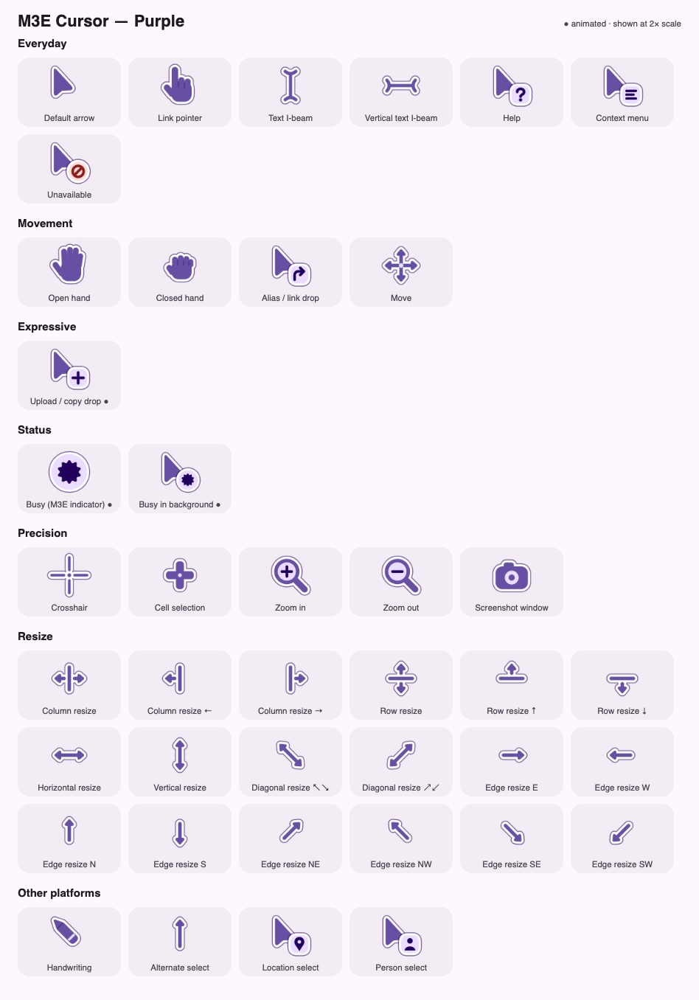

# M3E Cursor — Purple

A Material 3 Expressive cursor theme for macOS Tahoe 26, packaged for
[MaCursor](https://github.com/writronic/MaCursor).



Every cursor shares one shape vocabulary:

- **Shapes:** soft rounded corners, pills, and a squircle FAB badge.
- **Colours:** one purple tonal palette.
- **Edges:** a white rim and a thin dark hairline, so each cursor stays visible on light, dark and
  busy backgrounds.

The busy cursor is the official M3E **contained loading indicator**, rendered from
`@m3e/web`'s own `<m3e-loading-indicator>` component.

| | |
|---|---|
|  |  |
| Wait: official contained loading indicator, 4.666 s loop at 60 fps (GIF shown at 20 fps) | Copy / upload drop: FAB plus springs into an upload arrow |

## Install

1. Install MaCursor (macOS 13 or later; tested here on macOS 26.7.1 with MaCursor 2.7.5).
2. Double-click `dist/M3E-Purple.cursor`, or drag it onto MaCursor's library window, or use
   **File → Import Theme…**. If MaCursor is running only in the menu bar, open its library
   window first. A double-clicked theme can be dropped silently when no window is open.
3. Select **M3E Cursor Purple** and click **Apply**.

There's also `dist/M3E-Purple-ReducedMotion.cursor`. It's the same theme, but every animated
cursor holds its first frame. Cursors can't read the system's *Reduce motion* setting, so reduced
motion has to be a separate theme. To switch automatically, use MaCursor's per-app or scheduled
themes.

To change the size, use MaCursor → Settings → Cursor Control → **Cursor Scale**. Every slot ships at 32, 64 and 160 px, and static cursors also at 320 px. They stay
sharp up to 5× on Retina, and static cursors up to 10×.

## Supported roles

37 designs cover 47 MaCursor slots.

| Design | macOS role(s) | Hotspot (pt) |
|---|---|---|
| Default arrow | `Arrow`, `ArrowS` (Tahoe) | tip (5.9, 4.1) |
| Link pointer | `cursor.13` PointingHand | fingertip |
| Text I-beam | `IBeam`, `IBeamS` (Tahoe), `IBeamXOR` | centre |
| Vertical text | `cursor.26` IBeamH | centre |
| Help | `cursor.40` | arrow tip |
| Context menu | `ArrowCtx`, `cursor.24` | arrow tip |
| Unavailable / drop not allowed | `cursor.3` | arrow tip |
| Open hand / closed hand | `cursor.12` / `cursor.11` | palm |
| Move | `Move`, `cursor.39` | centre |
| Copy / upload drop (animated) | `Copy`, `cursor.5` | arrow tip |
| Alias / link drop | `Alias`, `cursor.2` | arrow tip |
| Crosshair | `cursor.7`, `cursor.8`, `cursor.20`, `cursor.10` (screenshot selection) | centre |
| Cell selection | `cursor.41` | centre |
| Zoom in / out | `cursor.42` / `cursor.43` | lens centre |
| Screenshot window | `cursor.9` | centre |
| Column resize ↔ ← → (with divider) | `cursor.19`, `cursor.17`, `cursor.18` | centre |
| Row resize ↕ ↑ ↓ (with divider) | `cursor.23`, `cursor.21`, `cursor.22` | centre |
| Window resize ↔ ↕ ⤡ ⤢ | `cursor.28`, `cursor.32`, `cursor.34`, `cursor.30` | centre |
| Window edge, one direction only | `cursor.27` E, `38` W, `31` N, `36` S, `29` NE, `33` NW, `35` SE, `37` SW | centre |
| Busy (animated) | `Wait` | centre |
| Busy in background (animated) | `cursor.4` | arrow tip |

**How the brief's roles map to macOS:**

- **Selection:** `cursor.41`, the Cell cursor.
- **Add, upload, drag-and-drop available:** all of these are `Copy`. That's the cursor macOS
  shows while you drag something onto a target that accepts a copy, such as a file over a browser
  upload area.
- **Drag-and-drop unavailable:** `cursor.3`.

**Roles left to macOS:**

- `Empty`, which is meant to be invisible.
- `cursor.0` and `cursor.1`, which MaCursor treats as aliases of Arrow and IBeam.
- `cursor.14` to `cursor.16`, the counting hands, which only a few legacy apps use.
- `cursor.25`, the Dock "poof".

**Tahoe variants:** macOS 26 added `ArrowS` and `IBeamS`. MaCursor normally mirrors Arrow and
IBeam into them. This theme also writes them explicitly, so they match even if you turn off
**Hide Tahoe cursors**.

## Known limitations

- **Frame rate of the busy cursors.** Both busy cursors store the official indicator at 60 fps:
  280 frames per 4.666 s cycle, the same layout as the MD3E Cursors gallery theme. MaCursor's
  preview plays all of them. According to MaCursor's source, its engine samples 24 frames when it
  applies a theme (a CoreGraphics cursor limit), so system-wide playback may be coarser. The cycle
  length and shape sequence stay official either way.
- **No transitions between cursors.** macOS swaps cursor images instantly, and animated cursors
  always loop. So the grab → grabbing change is a static pair drawn on the same palm grid. The
  upload cursor's "accepted ✓" stage isn't included either, because macOS has no "drop accepted"
  cursor role.
- **Apps control which cursor appears.** A role only shows when the app asks for it. Many web
  pages and Electron apps draw their own cursors or use only a few roles. The upload animation
  appears only when an app shows the Copy drag cursor.
- **Private APIs.** MaCursor applies themes through private CoreGraphics APIs. A macOS update can
  change or break that. Some apps reset the cursor; see MaCursor's
  [troubleshooting guide](https://github.com/writronic/MaCursor/blob/main/docs/troubleshooting.md).
- **1× displays.** At 32 px the art is anti-aliased from vector outlines, not hand-hinted. It
  looks softer than on Retina.

## Project layout

```text
design/      tokens.json, geometry.mjs (shape helpers), cursors.mjs (every cursor), animation-spec.md
cursors/     editable SVG export of each cursor (frame SVGs for the upload animation)
tools/       render.mjs, package.mjs, validate.mjs, previews.mjs, sheet.mjs
previews/    gallery (SVG + PNG, light and dark) and animation GIFs
dist/        M3E-Purple.cursor, M3E-Purple-ReducedMotion.cursor
build/       generated frames (not part of the distribution)
```

`design/cursors.mjs` is the source of truth. The SVGs in `cursors/` are exported from it on
every render, so you can open them in any vector editor. Edits you make there are for
exploration; to keep a change, move it back into `cursors.mjs`.

## Build

You need Node 20+, Google Chrome (used headless through Playwright) and Python 3. Python is only
used by the validator, to read the plist.

```bash
npm install
npm run build      # render → package → validate → previews
```

| Script | What it does |
|---|---|
| `npm run render` | Exports the SVGs and renders every cursor at 32/64/160/320 px (long animations stop at 160 px). Vector cursors are drawn at each device scale, so nothing is a bitmap upscale. Loading cursors are frames of the live `<m3e-loading-indicator>`, paused and seeked with the Web Animations API. |
| `npm run package` | Writes the two `.cursor` themes in MaCursor's native plist format, the same format as MaCursor's own `CursorThemeWriter.swift`. |
| `npm run validate` | Checks frame counts and sizes, alpha and clipping, hotspot placement, role coverage, and the plist rules MaCursor applies to its own themes. |
| `npm run previews` | Writes the gallery and animation GIFs. |
| `node tools/sheet.mjs out.png [frame] [names…]` | Inspection sheet at true 1× and 2× pixels over four backgrounds, with hotspots marked. |

## Credits and licence

- The loading indicator is the `m3e-loading-indicator` component from
  [matraic/m3e](https://github.com/matraic/m3e), MIT licence.
- Cursor artwork, tooling and documentation: MIT, see `LICENSE`.
